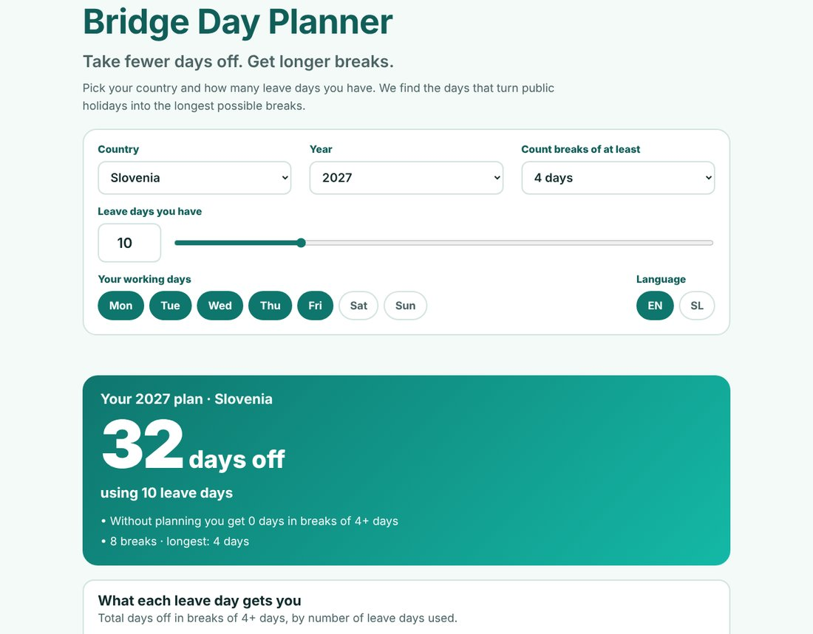
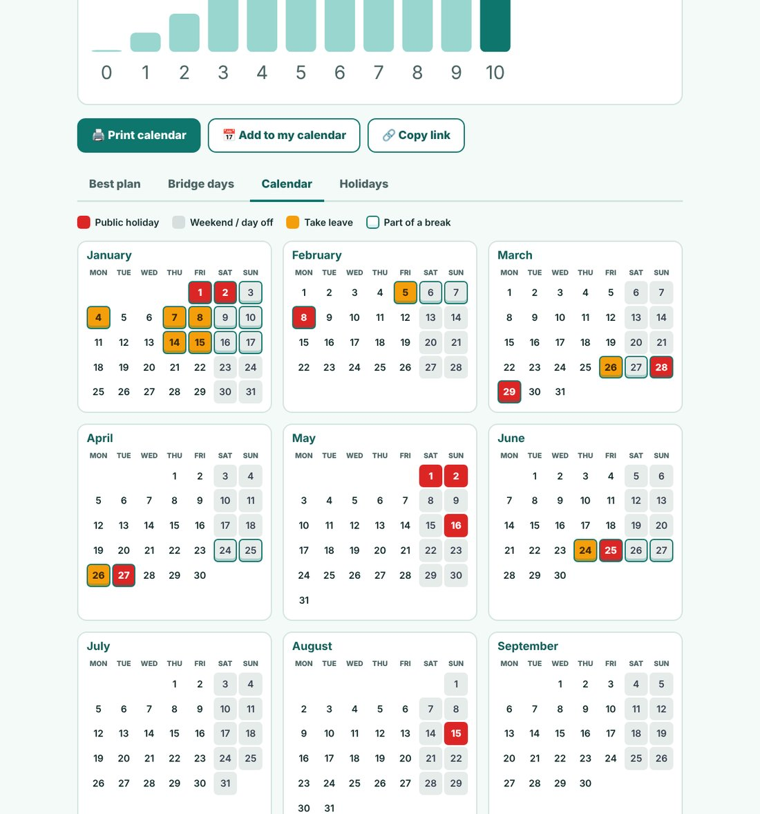
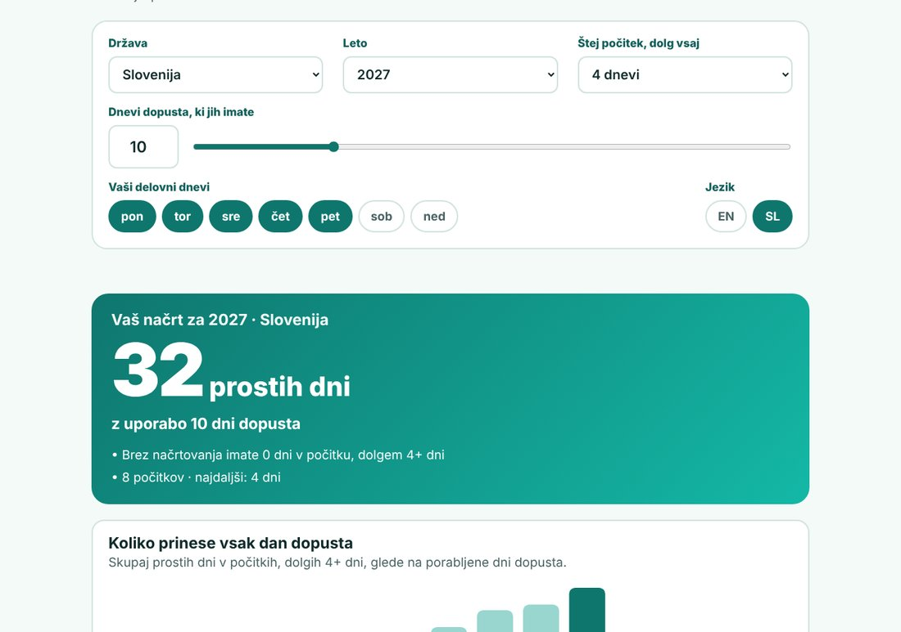

<div align="center">

# 🌉 Bridge Day Planner

### Take fewer days off. Get longer breaks.
Pick your country and how many leave days you have. The planner finds the days that turn public holidays and weekends into the longest possible breaks.

[](https://bridgedays-nu.vercel.app)
[](https://bridgedays-nu.vercel.app/mosticki-slovenija)


<br>



</div>

---

## ✨ What it does

A **bridge day** is a working day sitting between a public holiday and a weekend. Take just that day off and a Tuesday holiday becomes a four-day weekend for the price of **one** leave day.

This planner does that for the whole year at once:

- 🎯 **Best plan**: the exact days to take off to get the most days off, using no more leave than you have.
- 🌉 **Bridge days**: the classic one-day tricks, ranked by how many days off each leave day buys.
- 🗓️ **Calendar**: a full-year view with holidays, weekends, your leave and your breaks, ready to **print** on one A4 page.
- 📅 **Add to calendar**: download an `.ics` file for Google, Apple or Outlook calendar.
- 📈 **What each leave day gets you**: see where extra leave stops paying off.
- 🔗 **Share**: every setting lives in the link, so you can send your plan to a colleague.

<div align="center">

</div>

## 🌍 Works for your country

- **204 countries**, with holidays from the free [Nager.Date](https://date.nager.at) service.
- **Regional holidays** (for example Bavaria or Scotland) can be switched on by region.
- **Your own work week**: tap the days you work. Friday to Saturday weekends and Saturday shifts work too.
- **English and Slovenian**, with correct Slovenian plurals (1 dan, 2 dneva, 3 dnevi, 5 dni). The language follows your browser and you can change it.
- Dedicated pages for 26 countries and a Slovenian page, so each one is easy to find: [Slovenia](https://bridgedays-nu.vercel.app/bridge-days-slovenia), [Germany](https://bridgedays-nu.vercel.app/bridge-days-germany), [Austria](https://bridgedays-nu.vercel.app/bridge-days-austria), [United Kingdom](https://bridgedays-nu.vercel.app/bridge-days-united-kingdom), [United States](https://bridgedays-nu.vercel.app/bridge-days-united-states) and more.

<div align="center">

</div>

## 🧠 How the planning works

Choosing leave days is a small optimisation problem, and the answer is **exact**, not a rule of thumb.

1. Every day of the year (plus a margin either side, so New Year breaks are right) is marked as a working day, a day off, or a public holiday.
2. A dynamic-programming search tries every way of spending up to *N* leave days. Its score is the number of days that sit inside breaks of at least *M* days, where you choose *M* (3, 4, 5, 7 or 9).
3. It never takes leave on a holiday, a weekend or outside the chosen year.
4. The result is checked against a brute-force search in the tests, so you get the true best plan.

Only real days off count: holidays marked "Public" or "Bank". Observances, such as many commemorative days, are ignored.

## 🔒 Privacy and analytics

- **No accounts, no cookies, no database, no server of our own.** Everything is calculated in your browser.
- Holidays are fetched straight from Nager.Date and remembered on your device for a week. Your language choice is remembered too. That is all that is stored, and only in your own browser.
- The hosted site uses **[Vercel Web Analytics](https://vercel.com/docs/analytics)** to count anonymous page views. The snippet is two lines in each page (built from `scripts/build-pages.js`) and loads from `/_vercel/insights/script.js`. It only works on Vercel and does not use cookies.

## 🛠️ Run it yourself

Plain HTML, CSS and JavaScript. There is nothing to install.

```bash
git clone https://github.com/mskraban/bridge-day-planner.git
cd bridge-day-planner
python3 -m http.server 8000 --directory public   # then open http://localhost:8000
npm test                                          # 16 tests, including the brute-force check
npm run build                                     # regenerates the country pages and sitemap
```

Set `SITE_URL=https://your-domain npm run build` before deploying under your own address.

| Path | What it does |
| --- | --- |
| `public/planner.js` | The maths: day model, optimiser, bridges, breaks, calendar file |
| `public/holidays.js` | Loads and caches holidays from Nager.Date |
| `public/i18n.js` | English and Slovenian text and plural rules |
| `public/app.js` | The page: controls, results, calendar, print, sharing |
| `scripts/build-pages.js` | Generates the home page, the country pages, `sitemap.xml` and `robots.txt` |
| `test/` | Unit tests (`node --test`) using real Slovenian 2026-2028 holidays |

## ⚖️ Notes

- Holiday data comes from a third-party service. **Always check your employer's calendar**: company days, regional days and rules for holidays that fall on a weekend differ.
- Holidays that fall on a weekend are not moved to a weekday, because that rule is different in every country.
- If the holiday service is unreachable, the page uses the last saved list from your device.

<div align="center">

---

Built with plain HTML, CSS and JavaScript · tested with `node --test` · hosted on Vercel

</div>
